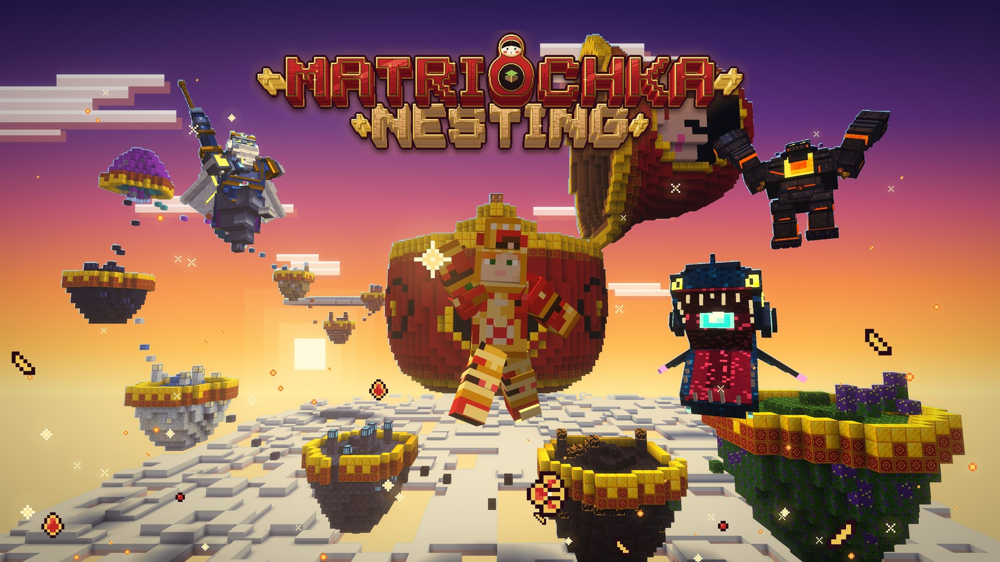
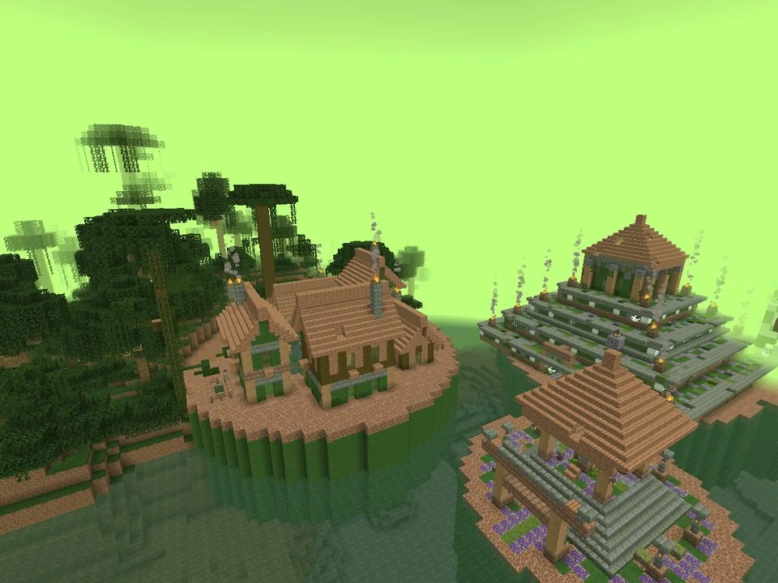
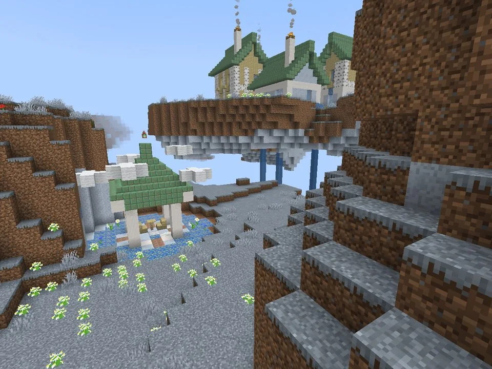
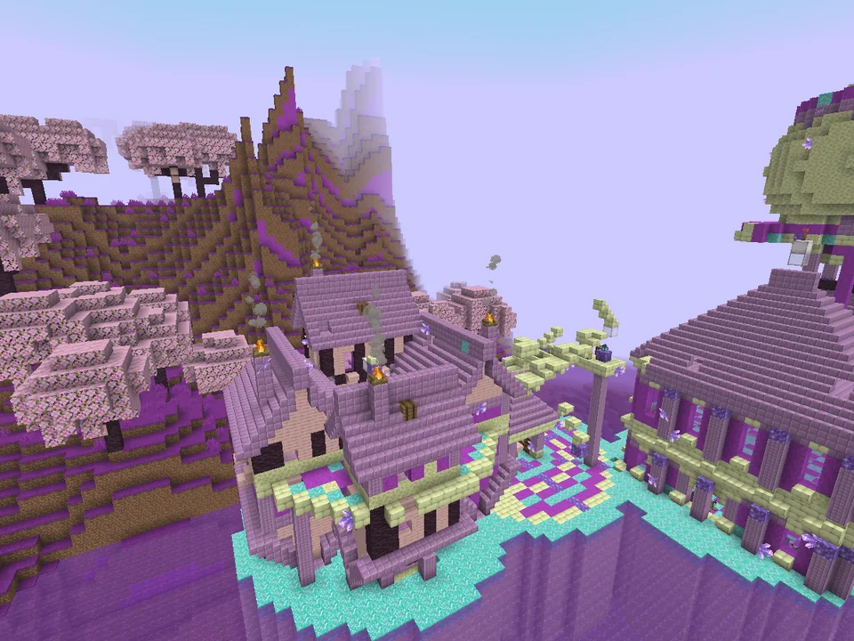
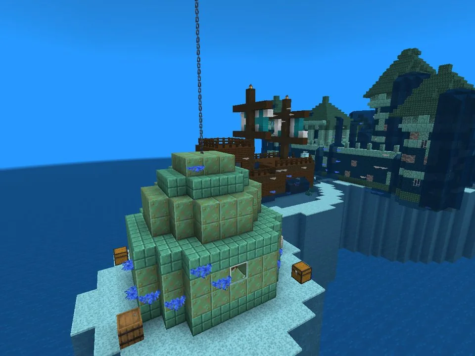
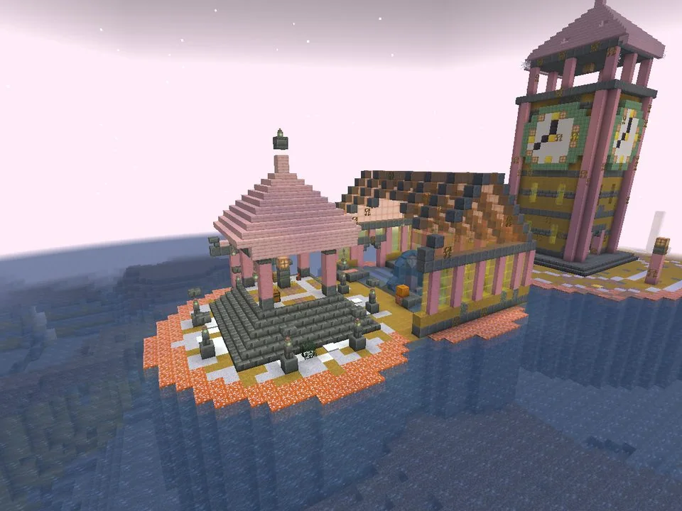
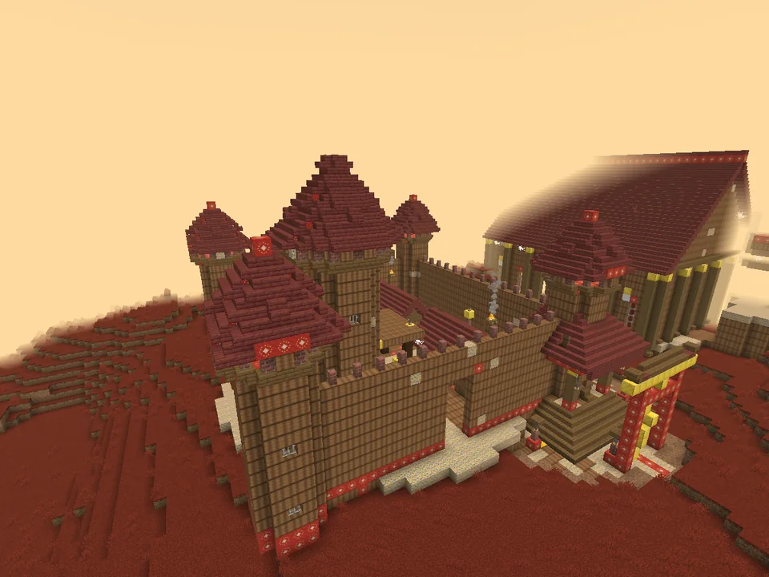

<p align="center"></p>

<h1 align="center">Matriochka</h1>

<p align="center"><b>Every block can hold a world.</b></p>

<p align="center">
  <a href="https://achedon12.github.io/matriochka/">Website</a> ·
  <a href="https://github.com/achedon12/matriochka/wiki">Wiki</a> ·
  <a href="https://github.com/achedon12/matriochka/releases">Download</a> ·
  <a href="https://discord.gg/SPVCf5hRuh">Discord</a>
</p>

<p align="center">
  <a href="https://www.curseforge.com/minecraft/mc-mods/matriochka"></a>
  <a href="https://modrinth.com/mod/matriochka"></a>
  <a href="https://github.com/achedon12/matriochka/releases"></a>
</p>

<p align="center"></p>

Matriochka is a progression mod for Minecraft Java 26.1.2, 26.2 and 26.3 on Fabric. Ten worlds are nested inside blocks, one inside the other, like the dolls it is named after.

You craft a Seed, plant it on tilled World Soil next to water, and the block that hatches holds a whole world: its own rule, creatures and people, its own crafting station, and a boss at the end. Beat the boss, take its core, and the way into the next world opens. Every world after the first opens with its own object and its own rite.

It starts in your normal world, with the Block Guardian a few hundred blocks from spawn, and it ends in World 0, the smallest doll, which only the ten hidden dolls open.

The mod is in beta (0.9.0): every world, boss and ending is playable, and it is being polished.

## The ten worlds

| World | Rule | What it does to you |
| --- | --- | --- |
| 1. Toxic Jungle | Toxin | Builds every second out of water or rain |
| 2. Giant Veins | Heat | Lava and depth cook you; water and thermal armour cool you |
| 3. Endless Dungeon | Locks | Sealed doors need keys, and the halls move every five minutes |
| 4. Storm Archipelago | Wind | Gusts every 30 seconds, announced lightning, no elytra |
| 5. Lightless Deep | Noise | Sprint and everything near hunts you; placed lights die in a minute |
| 6. Upside Realm | Gravity | A third of the land flips gravity, the pattern changes every 90 seconds |
| 7. Pressure Ocean | Oxygen | No dry land; breath, snorkel tanks and crushing depth |
| 8. Hastened Seasons | Season | Eight-minute days, two-minute seasons, hungry summers, slow winters |
| 9. Restless Ground | Tremor | Every minute, whole zones of ground rise, sink, slide or close |
| 10. The Giant Workshop | Synthesis | The nine rules before it, one per zone |

<p align="center">
  
  <br>
  
  <br>
  
  
</p>

## What is inside

| | |
| --- | --- |
| 10 worlds and World 0 | Each with its own rule, creatures, people, station, structures, wonder and boss |
| 12 bosses | Every attack is announced, executed, then leaves an opening. Phases at 66% and 33% of health. Health scales with the players near the fight. Each has its own model, boss bar and music theme |
| 50 creatures | Ambushers, mimics, sound hunters, nesting mobs that split on death, each with its own GeckoLib model and moves |
| 13 stations | Each with one mechanic: fermentation, temperature, lock patterns, lightning, darkness, depth, time of day |
| The Artisan's Journal | Objective, 70 optional quests, karma, a card for every world's items and how to get them, a map inked as you walk, 50 pages of story |
| 10 wonders | One great place per world, with a reliquary that only another world's cross key opens. Each relic gives a heart for good and its world's gift |
| 10 world ores | One per world, each obtained its own way, nested in the Nesting Cradle into Matriochkite |
| Matriarch Armour | The finest set, whose Nested Shell halves every world's gauge and turns one deadly blow every five minutes |
| Equipment classes | Gear rolls Guardian, Berserker, Prowler, Reaper, Survivor or Prospector when crafted, up to level 5, with 72 talents |
| Souls and karma | Every item holds a soul; purify it or devour it. Karma changes prices, quests, people and your ending |
| Doll of Life | Each layer saves you from one death. Soul Cradles and death chests do the rest |
| 110 structures | Eleven per world, with Journal pages and a hidden doll in each world |
| Endings and replay | Three endings, a New Cycle with mutated bosses, and the Trials with a server leaderboard |
| 100 achievements | One advancement tab per world |
| Comfort | Options > Matriochka...: screen shake, flashes, soft effects, cinematics, subtitles, particles, gauge patterns, HUD and music volumes |
| Groups | Up to 8 players share worlds and bosses; each keeps their own souls, karma and quests |
| 9 languages | English, French, Spanish, German, Brazilian Portuguese, Italian, Russian, Polish, Simplified Chinese |

## New in 0.9.0: Nesting

Every world now has an ore of its own, each obtained its own way: grown on blooms by the water, mined with a burning hand or in total silence, fused by lightning, falling upwards, dropped by the creatures of the deep, ripened from a seed in two minutes. Set the ten in the Nesting Cradle and an eight-second ritual of ten nesting dolls turns them into a Matriochkite Ingot, the metal of the Matriarch Armour: 32 armour, 18 toughness, a heart per piece, and the Nested Shell. See the [wiki page](https://github.com/achedon12/matriochka/wiki/World-Ores-and-the-Matriarch) and the [changelog](CHANGELOG.md).

<p align="center">
  
  
</p>

<!-- gui -->
<p align="center"> <br> </p>
<!-- /gui -->

Want it set up in one click? The [Matriochka Pack](https://modrinth.com/modpack/matriochka-pack) (also on [CurseForge](https://www.curseforge.com/projects/1791269)) is the mod with its libraries, recipe pages and client performance mods, in a normal and a hard version.

## Requirements

- Minecraft Java Edition 26.3, 26.2 or 26.1.2 (one jar for each)
- Fabric Loader 0.20.0 or newer
- [Fabric API](https://modrinth.com/mod/fabric-api)
- [GeckoLib](https://modrinth.com/mod/geckolib) for your Minecraft version (5.5.7+ on 26.3, 5.5.5+ on 26.2, 5.5.2+ on 26.1.2)
- Java 25

The mod must be installed on the server and on every client. It works in singleplayer, on servers and on Lunar Client (Fabric profile).

## Getting started

1. You wake up with the Artisan's Scroll. Read it.
2. Find the Guardian's Sanctuary, a ring of stone pillars around an altar, a few hundred blocks from spawn.
3. Use the altar and defeat the Block Guardian. It drops its core, the Matrix Workbench and World Soil.
4. Craft the World 1 Seed, till the World Soil with a hoe, plant the Seed next to water and wait for it to hatch.
5. Use the World Block to enter. The Threshold or a Return Thread brings you back.

The full guide lives in the [wiki](https://github.com/achedon12/matriochka/wiki).

## Commands

| Command | Effect |
| --- | --- |
| `/matriochka group info / invite / join / leave` | Manage your group (up to 8 players share their worlds) |
| `/matriochka karma show` | Show your karma and souls |
| `/matriochka progression set <world>` | Operators: set the group's progression |
| `/matriochka world enter <n>` / `leave` | Operators: travel between worlds |
| `/matriochka boss <id>` | Operators: summon a boss for testing |
| `/matriochka debug` | Operators: current world, parcel, gauges |

## Building from source

```sh
python3 tools/gen.py        # regenerate textures, models, lang files and data from tools/content.py
./gradlew build             # build the mod jar into build/libs
./gradlew runClient         # start a development client
./gradlew runClientGameTest # load every world, wake every boss and save screenshots
```

All content (worlds, items, mobs, bosses, structures, quests, achievements) is described once in `tools/content.py`. The generator writes the textures, the GeckoLib models and animations (they open in Blockbench), the English and French translations, the dimensions, biomes and structures, and the generated Java definitions.

## Project layout

```
tools/            content table, texture painter, model generator, GUI sprites
src/main/java     server and common logic (worlds, rules, bosses, stations, karma, classes)
src/client/java   renderers, HUD, Journal and station screens
src/gametest/java showcase test that visits every world
design/           original design notes
site/             website (Next.js, GitHub Pages)
```

## Status

Matriochka is in beta: the whole game is there and is being polished. All ten worlds, their rules, mobs, bosses, stations and progression are playable. Every creature and boss has its own hand-built GeckoLib model, animations and attacks. See the [roadmap](https://github.com/achedon12/matriochka/wiki/Roadmap) for what comes next.

## Contributing

Matriochka is open source and contributions are welcome: bug reports, balance feedback, translations, models and code. Start with [CONTRIBUTING.md](CONTRIBUTING.md), which explains how the content table and the generators fit together. Everyone taking part follows the [code of conduct](CODE_OF_CONDUCT.md); security issues go through the [security policy](SECURITY.md).

## License

Code and assets are released under the [MIT License](LICENSE).

Made by [achedon12](https://github.com/achedon12).
