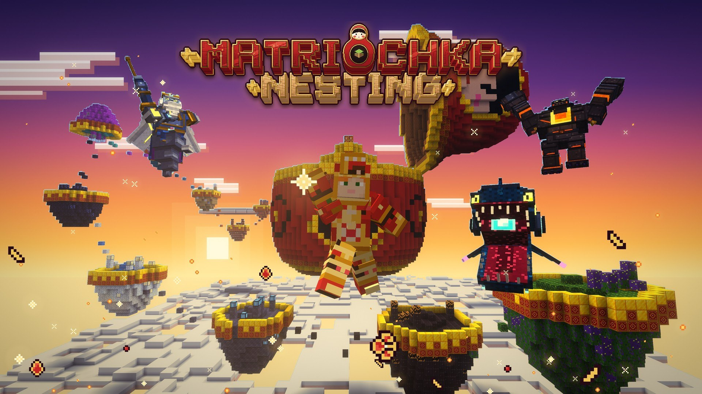

**Matriochka, set up and ready to play.** This pack is the [Matriochka](https://www.curseforge.com/minecraft/mc-mods/matriochka) mod for Minecraft 26.3, 26.2 or 26.1.2 on Fabric (one file for each), with its required libraries and a set of client performance mods. Nothing else changes the game: no extra content, no tweaks to vanilla, only the mod and what makes it run well.

Matriochka is a progression mod. Ten worlds are nested inside blocks, one inside the other, like the dolls it is named after. You craft a Seed, plant it on tilled World Soil, and the block that hatches holds a whole world with its own rule, creatures, station and boss. Beat the boss, take its core, and the next Seed becomes possible.

**New in 0.9.0, Nesting:** every world has an ore of its own, each obtained its own way. Set the ten in the Nesting Cradle and a ritual of ten nesting dolls turns them into Matriochkite, the metal of the Matriarch Armour and its Nested Shell. Matriochka is now in beta. Full notes in the [changelog](https://github.com/achedon12/matriochka/blob/main/CHANGELOG.md).

## Two versions

- **Matriochka Pack**: difficulty `normal`, the mod's defaults. Pick it to play the game as designed.
- **Matriochka Pack (Hard)**: difficulty `nightmare`. Creatures and bosses hit 30% harder and Soul Cradles hold one charge instead of three. For a second cycle, or a group that wants it tight.

Both have the same mods; only `config/matriochka.json` differs, and a server operator can change it at any time (`difficulty`: `story`, `normal`, `nightmare` or `hardcore`, see [Configuration](https://github.com/achedon12/matriochka/wiki/Configuration)). The normal version is uploaded last for each release, so it is the newest file; the hard one is in the *Files* tab.

## What is inside

- **[Matriochka](https://www.curseforge.com/minecraft/mc-mods/matriochka)** (client and server): the mod itself.
- **[Fabric API](https://www.curseforge.com/minecraft/mc-mods/fabric-api)** (client and server): required by Matriochka.
- **[GeckoLib](https://www.curseforge.com/minecraft/mc-mods/geckolib)** (client and server): required, the models and animations of the 50 creatures and 12 bosses.
- **[Just Enough Items](https://www.curseforge.com/minecraft/mc-mods/jei)** and **[MezzConfig](https://www.curseforge.com/minecraft/mc-mods/mezzconfig)** (client, optional): a recipe page for each of the thirteen stations. Included in the versions where CurseForge has approved the matching JEI file.
- **[Sodium](https://www.curseforge.com/minecraft/mc-mods/sodium)** (client): a much higher frame rate, mostly in the dense worlds.
- **[Lithium](https://www.curseforge.com/minecraft/mc-mods/lithium)** (client and server): faster game logic, mob AI, physics and chunk ticking. Every world is a separate dimension, so this adds up.
- **[FerriteCore](https://www.curseforge.com/minecraft/mc-mods/ferritecore-fabric)** (client and server): less memory, which matters with eleven extra dimensions over a playthrough.
- **[Entity Culling](https://www.curseforge.com/minecraft/mc-mods/entityculling)** (client): skips creatures and block entities you cannot see.
- **[ImmediatelyFast](https://www.curseforge.com/minecraft/mc-mods/immediatelyfast)** (client): faster HUD, text and map rendering.
- **[Dynamic FPS](https://www.curseforge.com/minecraft/mc-mods/dynamic-fps)** (client): lowers the frame rate when the game is in the background.
- **[Krypton](https://www.curseforge.com/minecraft/mc-mods/krypton)** (client and server): a lighter network stack, for servers.
- **[Iris Shaders](https://www.curseforge.com/minecraft/mc-mods/irisshaders)** (client, optional): shaders, if you want them. Off unless you load a shader pack.

Every mod is the CurseForge copy of the exact file the Modrinth version of the pack uses. The pack also sets render distance 10 and simulation distance 8 in `options.txt`.

**Not in the CurseForge version for 26.3: Mod Menu.** It needs Placeholder API, which has no 26.3 file on CurseForge, and CurseForge packs can only hold CurseForge files. The 26.2 and 26.1.2 versions have it. Matriochka works the same without it; its comfort options are in Options > Matriochka.... The Modrinth version of the pack has Mod Menu.

## Left out on purpose

- **LambDynamicLights.** A torch in your hand would light the Lightless Deep, and the whole point of World 5 is that it is dark: its rule is noise, its creatures hunt what they hear, and light is something you place. Dynamic lights would defeat that rule.
- **Minimaps.** A personal choice, and a map is not needed. They work with Matriochka if you add them; Xaero's cave view and radar are turned off inside World 5 (see [Compatibility](https://github.com/achedon12/matriochka/wiki/Compatibility)).
- **C2ME and ScalableLux** (both rewrite chunk generation and lighting; alpha builds only for C2ME, and for ScalableLux on 26.3), **ModernFix, MemoryLeakFix and Noisium** (no Fabric build for these versions).
- Content mods of any kind. The pack is Matriochka and nothing else, so a bug report is a Matriochka bug report.

## Install

- **CurseForge app:** *Install* on this page, or search "Matriochka Pack" in the app's Minecraft modpacks. For the hard version, pick the `-hard` file in the *Files* tab.
- **Prism Launcher:** *Add Instance* → *CurseForge* → "Matriochka Pack". Entity Culling does not allow third-party launchers to download it, so Prism asks you to download that one file in your browser; the Modrinth version of the pack avoids this.

You need Java 25; the CurseForge app downloads it for you.

## Running a server

Matriochka has to be on the server and on every client. On a Fabric server of the same Minecraft version (Fabric Loader 0.20.0 or newer, Java 25), put these in `mods/`:

- **Required:** Matriochka, Fabric API, GeckoLib
- **Recommended:** Lithium, FerriteCore, Krypton (server side only)

Leave the client mods (Sodium, Iris, Entity Culling, ImmediatelyFast, Dynamic FPS, JEI) off the server. For the hard version, copy the pack's `config/matriochka.json` into the server's `config/` folder. Server rules and commands: [Configuration](https://github.com/achedon12/matriochka/wiki/Configuration), [Commands](https://github.com/achedon12/matriochka/wiki/Commands), [Multiplayer and groups](https://github.com/achedon12/matriochka/wiki/Multiplayer-and-Groups).

## Links

- Website: [achedon12.github.io/matriochka](https://achedon12.github.io/matriochka/)
- Wiki: [github.com/achedon12/matriochka/wiki](https://github.com/achedon12/matriochka/wiki)
- Source, issues and releases: [github.com/achedon12/matriochka](https://github.com/achedon12/matriochka)
- Discord: [discord.gg/SPVCf5hRuh](https://discord.gg/SPVCf5hRuh)

Matriochka and the pack are MIT licensed; each included mod keeps its own license.
